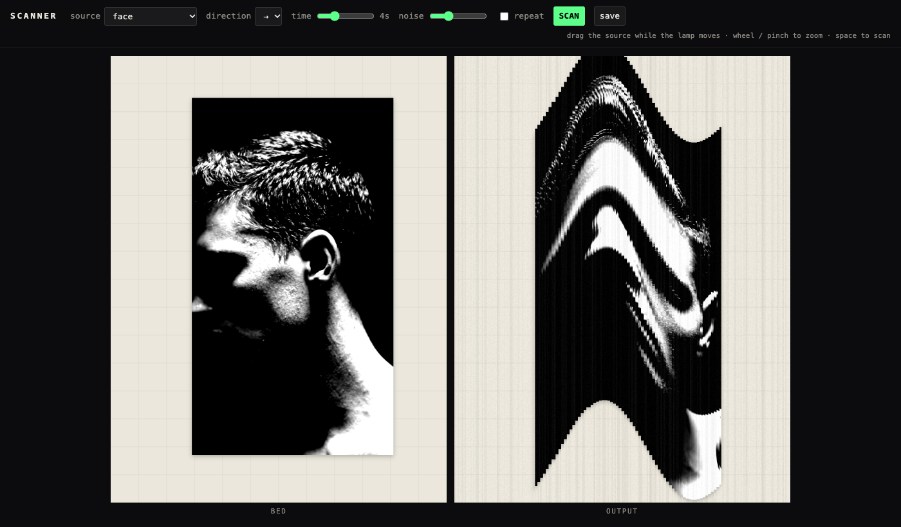

# scanner

A scanner glitch you can play with in the browser. A green lamp sweeps across the bed and copies only the line it is passing over into the output. Drag the source while the lamp moves, and every column (or row) keeps the moment it was read: smears, waves, cuts and repeats.

- Live: https://verytired.github.io/scanner/

## How to use

- **SCAN** (or the space key) starts a sweep. Drag the source on the left while the lamp moves.
- Wheel or pinch to zoom the source.
- **direction**: → ← ↓ ↑. **time**: how long one sweep takes (1–12 s). **noise**: uneven sensor brightness and grain. **repeat**: scan again and again.
- **source**: two black-and-white videos (face, dancer), your own photo or video, or your camera. The sources are videos, so they leave motion in the scan even when you hold still.
- **save** downloads the output as a PNG.
- The carriage motor hums while scanning, higher when the sweep is faster, and whirs back when it ends.

## How it works

Every frame the bed (glass, grid and the source at its current position) is drawn to an offscreen canvas. The lamp has moved a few pixels since the last frame; only that strip is copied from the bed into the output. Nothing else is computed: the distortion is just time, spread across space by the moving lamp.

One HTML file, no libraries. The sound is Web Audio (a sawtooth and a square through a band-pass for the motor, a falling sweep for the return).

## Credits

The face and dancer videos were generated with Veo. Inspired by a scanner glitch tool by yhhydesign.
